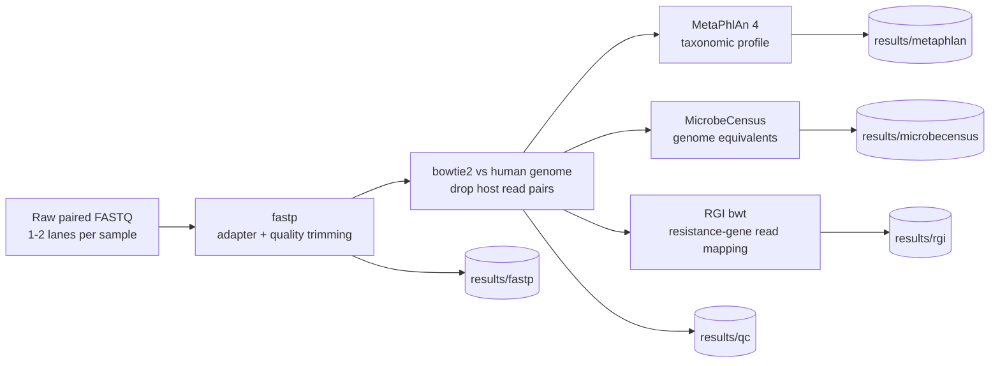

# Part 1: Profiling metagenomes by short-read mapping

**MetaPhlAn 4 (taxonomy) and RGI bwt (antimicrobial resistance genes) on a SLURM cluster**

In this part you will see how to turn raw paired-end shotgun FASTQ files into three sets of tables that Part 2 analyses in R:

- a **taxonomic profile** per sample (MetaPhlAn 4),
- a **resistome profile** per sample (RGI bwt against the CARD database),
- an estimate of **genome equivalents** per sample (MicrobeCensus), used to put resistance-gene counts on a comparable scale.

Everything is driven by one SLURM job array: one array task = one sample.

---

**Installation is not covered here.** Section 3 links each tool's own GitHub page, with the versions used in this workshop. Install the tools and databases by following those pages, then come back to section 4.

---

## Contents

1. [How the workflow fits together](#1-how-the-workflow-fits-together)
2. [What each tool does](#2-what-each-tool-does)
3. [Tools and versions: installation links](#3-tools-and-versions-installation-links)
4. [Describe your samples: manifest and config](#4-describe-your-samples-manifest-and-config)
5. [The pipeline script](#5-the-pipeline-script)
6. [Run it](#6-run-it)
7. [What you get, and how to sanity-check it](#7-what-you-get-and-how-to-sanity-check-it)
8. [Troubleshooting](#8-troubleshooting)
9. [References](#9-references)

---

## 1. How the workflow fits together



---

## 2. What each tool does

**fastp** is a single-pass FASTQ preprocessor. For paired-end data it detects adapters by overlap, trims low-quality ends with a sliding window, removes poly-G tails (an artefact of the two-colour chemistry on NovaSeq/NextSeq instruments), drops reads that become too short, and writes a JSON report that Part 2 uses for read-level QC.

**Host removal (bowtie2 + samtools)** aligns every read pair to the human reference genome and keeps only pairs in which *neither* mate aligns. Removing host reads protects participant privacy when you share data, saves compute, and prevents human DNA from distorting downstream processing.

**MetaPhlAn 4** is a marker-gene profiler. Reads are mapped to a database of clade-specific marker genes derived from isolate genomes and metagenome-assembled genomes (about one million in MetaPhlAn 4's original database), organised into species-level genome bins (SGBs; the `vJan25` database used here contains 58,331). The abundance of a clade is estimated from the coverage of its markers, which makes it fast and specific, but it can only report organisms that have markers in the database. With `-t rel_ab_w_read_stats` it also reports the estimated number of reads per clade, which Part 2 uses as counts.

**MicrobeCensus** estimates the *average genome size* of the community from reads that map to 30 universal single-copy gene families. Dividing the total number of sequenced bases by the average genome size gives **genome equivalents**: roughly "how many genomes' worth of DNA did we sequence". Normalising gene counts per genome equivalent corrects for the fact that communities differ in average genome size, which otherwise biases comparisons of gene abundance.

**RGI bwt** (Resistance Gene Identifier, read-mapping mode) aligns reads to the reference sequences of the **CARD** database using bowtie2 and reports, for each resistance gene (ARO term), how many reads mapped and how much of the gene they cover.

---
---

## 3. Tools and versions: installation links

Follow each project's own installation instructions. The versions below are the ones this workshop was written against; note the exact versions you end up with.

| Tool | What we use it for | Version in this workshop | Install and documentation |
|---|---|---|---|
| fastp | Adapter and quality trimming | Any recent release (not pinned) | [OpenGene/fastp](https://github.com/OpenGene/fastp) |
| bowtie2 | Host removal and RGI read mapping | Any recent 2.x release (not pinned) | [BenLangmead/bowtie2](https://github.com/BenLangmead/bowtie2) |
| samtools | Filtering host alignments, BAM to FASTQ | Any recent release (not pinned) | [samtools/samtools](https://github.com/samtools/samtools) (see its `INSTALL` file) |
| MetaPhlAn | Taxonomic profiling | **4.2.2** | [biobakery/MetaPhlAn](https://github.com/biobakery/MetaPhlAn); [MetaPhlAn 4.2 wiki](https://github.com/biobakery/MetaPhlAn/wiki/MetaPhlAn-4.2) |
| MetaPhlAn database | Marker-gene database | **`mpa_vJan25_CHOCOPhlAnSGB_202503`** | Install with the commands on the MetaPhlAn wiki page above |
| MicrobeCensus | Average genome size, genome equivalents | Any release providing `run_microbe_census.py` (not pinned) | [snayfach/MicrobeCensus](https://github.com/snayfach/MicrobeCensus) |
| RGI | Resistance-gene read mapping (`rgi bwt`) | Not pinned; use the release that matches your CARD download | [arpcard/rgi](https://github.com/arpcard/rgi): [installation](https://github.com/arpcard/rgi#installation), [`rgi bwt`](https://github.com/arpcard/rgi/blob/master/docs/rgi_bwt.rst), [loading CARD](https://github.com/arpcard/rgi/blob/master/docs/rgi_load.rst) |
| CARD | Resistance-gene reference database | Record the version you download | [card.mcmaster.ca](https://card.mcmaster.ca/) |
| Human reference | Host removal | T2T-CHM13v2.0 (any bowtie2-indexed human reference works) | [marbl/CHM13](https://github.com/marbl/CHM13); build a bowtie2 index and point `HOST_INDEX` at its prefix |

Things to know before you configure the pipeline:

- **MetaPhlAn 4.2.2 matters.** The `vJan25` database needs MetaPhlAn 4.2 or newer, and 4.2 renamed two flags (`--bowtie2db` became `--db_dir`, `--bowtie2out` became `--mapout`). The script uses the new names. A profile can only be compared with profiles made from the **same database index**, so the index is pinned in `config.sh`.
- **Environments.** The script expects the general tools (fastp, bowtie2, samtools, pigz, MetaPhlAn, MicrobeCensus) in one conda environment and RGI in a second. Their names go in `config.sh` (`ENV_PROFILING`, `ENV_RGI`). If MicrobeCensus will not install alongside the others, give it its own environment and set `ENV_MICROBECENSUS`.
- **RGI database.** The script runs `rgi bwt ... --local` and expects a `localDB/` directory inside `RGI_DB_DIR`. The RGI docs linked above explain how to create it.
- The pipeline saves package lists to `results/software_versions/`, so your versions are recorded automatically.

---

## 4. Describe your samples: manifest and config

### 4.1 The manifest

`manifest.tsv` is a **tab-separated** table with one row per sample. `Lib2_F` / `Lib2_R` are only filled in when a sample was sequenced on a second lane or run; the pipeline then merges the two libraries (R1 with R1, R2 with R2). File names are relative to `READS_DIRECTORY`.

| SampleID | Lib1_F | Lib1_R | Lib2_F | Lib2_R |
|---|---|---|---|---|
| P01_T1 | P01_T1_R1.fastq.gz | P01_T1_R2.fastq.gz | | |
| P01_T2 | P01_T2_L1_R1.fastq.gz | P01_T2_L1_R2.fastq.gz | P01_T2_L2_R1.fastq.gz | P01_T2_L2_R2.fastq.gz |

The `SampleID` values must match the sample identifiers in your metadata file in Part 2. If your files are simply named `<sample>_R1.fastq.gz` / `<sample>_R2.fastq.gz`, this builds the manifest for you:

```bash
cd /path/to/workshop
( printf 'SampleID\tLib1_F\tLib1_R\tLib2_F\tLib2_R\n'
  for r1 in reads/*_R1.fastq.gz; do
    base="$(basename "${r1}" _R1.fastq.gz)"
    printf '%s\t%s\t%s\t\t\n' "${base}" "$(basename "${r1}")" "${base}_R2.fastq.gz"
  done ) > manifest.tsv
column -t -s $'\t' manifest.tsv | head      # check it looks right
```

### 4.2 The config file

All paths and switches live in `config.sh`. **Edit this file only**; the pipeline script reads it and never needs changing. Use absolute paths.

`config.sh`

```bash
#!/bin/bash
# config.sh -- edit this file only; run_profiling.sh sources it.
# All paths must be ABSOLUTE (SLURM runs the script from a spool copy).

# ---- Project paths -----------------------------------------------------------
PROJECT_DIR="/path/to/workshop"
MANIFEST="${PROJECT_DIR}/manifest.tsv"        # see "Manifest" in the tutorial
READS_DIRECTORY="${PROJECT_DIR}/reads"        # flat directory of raw FASTQ files
OUT_DIR="${PROJECT_DIR}/results"              # all outputs land here
SCRATCH_DIR="${SCRATCH_DIR:-${TMPDIR:-/tmp}}" # fast local/scratch space for temp files

KEEP_QC_READS=false                           # keep host-depleted reads? (large)
QC_READS_DIR="${PROJECT_DIR}/qc_reads"

# ---- Reference databases (installed beforehand; see section 3) -----------------
HOST_INDEX="/path/to/databases/host/T2T_CHM13v2"             # bowtie2 index PREFIX
METAPHLAN_DB_DIR="/path/to/databases/metaphlan"              # --db_dir
METAPHLAN_INDEX="mpa_vJan25_CHOCOPhlAnSGB_202503"            # pinned; do not use "latest"
RGI_DB_DIR="/path/to/databases/card"                         # directory CONTAINING localDB/

# ---- Software environments ---------------------------------------------------
# If conda is not on PATH inside batch jobs, set CONDA_BASE explicitly
# (e.g. CONDA_BASE="${HOME}/miniforge3") or add `module load` lines here.
CONDA_BASE="${CONDA_BASE:-$(conda info --base)}"
ENV_PROFILING="mgs-profiling"   # fastp, bowtie2, samtools, pigz, metaphlan, microbecensus
ENV_MICROBECENSUS="${ENV_PROFILING}"   # point to a separate env if the solver cannot combine them
ENV_RGI="mgs-rgi"               # rgi

# ---- Which steps to run ------------------------------------------------------
RUN_METAPHLAN=true
RUN_MICROBECENSUS=true          # genome equivalents, used to normalise ARG counts
RUN_RGI=true

# ---- QC parameters -----------------------------------------------------------
MIN_READ_LENGTH=60              # fastp --length_required
```

---

---

## 5. The pipeline script

Save as `run_profiling.sh` next to `config.sh`. It is annotated step by step; the notes below the code explain the design decisions.

`run_profiling.sh`

```bash
#!/bin/bash
#SBATCH --job-name=mgs_profile
#SBATCH --nodes=1
#SBATCH --ntasks=1
#SBATCH --cpus-per-task=16
#SBATCH --mem=48G
#SBATCH --time=12:00:00
#SBATCH --output=logs/%x_%A_%a.out
#SBATCH --error=logs/%x_%A_%a.err
##SBATCH --account=YOUR_ALLOCATION
##SBATCH --partition=YOUR_PARTITION
#
# Submit (array size = number of samples in the manifest, header excluded):
#   mkdir -p logs
#   sbatch --array=1-"$(( $(wc -l < manifest.tsv) - 1 ))" run_profiling.sh
#
# Per sample: merge lanes -> fastp -> host removal -> MetaPhlAn 4 / MicrobeCensus / RGI bwt.
# Re-submitting is safe: samples whose final outputs already exist are skipped.

set -euo pipefail

log() { echo "[$(date '+%F %T')] [${SAMPLE_ID:-setup}] $*"; }
die() { echo "ERROR: $*" >&2; exit 1; }

# ---- 0. Configuration and validation -----------------------------------------
CONFIG_FILE="${CONFIG_FILE:-${SLURM_SUBMIT_DIR:-${PWD}}/config.sh}"
[[ -f "${CONFIG_FILE}" ]] || die "config file not found: ${CONFIG_FILE}"
# shellcheck source=/dev/null
source "${CONFIG_FILE}"

for required_variable in MANIFEST READS_DIRECTORY OUT_DIR SCRATCH_DIR HOST_INDEX \
                         CONDA_BASE ENV_PROFILING ENV_MICROBECENSUS ENV_RGI \
                         MIN_READ_LENGTH; do
  [[ -n "${!required_variable:-}" ]] || die "config variable ${required_variable} is empty"
done

TASK_ID="${SLURM_ARRAY_TASK_ID:-1}"
THREADS="${SLURM_CPUS_PER_TASK:-4}"
FASTP_THREADS=$(( THREADS > 16 ? 16 : THREADS ))   # fastp supports at most 16 threads

[[ -f "${MANIFEST}" ]] || die "manifest not found: ${MANIFEST}"
[[ -d "${READS_DIRECTORY}" ]] || die "reads directory not found: ${READS_DIRECTORY}"
compgen -G "${HOST_INDEX}.1.bt2*" > /dev/null || die "no bowtie2 index at prefix ${HOST_INDEX}"
if [[ "${RUN_METAPHLAN}" == true ]]; then
  [[ -d "${METAPHLAN_DB_DIR}" ]] || die "MetaPhlAn database directory not found"
  [[ -n "${METAPHLAN_INDEX}" && "${METAPHLAN_INDEX}" != "latest" ]] \
    || die "pin METAPHLAN_INDEX to an explicit database version"
fi
if [[ "${RUN_RGI}" == true ]]; then
  [[ -d "${RGI_DB_DIR}/localDB" ]] || die "no localDB in RGI_DB_DIR (run rgi load --local in that directory)"
fi

# ---- 1. Read this task's sample from the manifest ----------------------------
# Row 1 is the header, so task N reads file line N + 1.
MANIFEST_ROW="$(sed -n "$(( TASK_ID + 1 ))p" "${MANIFEST}" | tr -d '\r')"
[[ -n "${MANIFEST_ROW}" ]] || die "no manifest row for array task ${TASK_ID}"
IFS=$'\t' read -r SAMPLE_ID LIB1_R1 LIB1_R2 LIB2_R1 LIB2_R2 <<< "${MANIFEST_ROW}"
LIB2_R1="${LIB2_R1:-}"
LIB2_R2="${LIB2_R2:-}"
[[ -n "${SAMPLE_ID}" && -n "${LIB1_R1}" && -n "${LIB1_R2}" ]] \
  || die "manifest row ${TASK_ID} needs SampleID, Lib1_F and Lib1_R"
if [[ -n "${LIB2_R1}" && -z "${LIB2_R2}" ]]; then
  die "${SAMPLE_ID}: Lib2_F is set but Lib2_R is empty"
fi

FINAL_METAPHLAN="${OUT_DIR}/metaphlan/${SAMPLE_ID}.metaphlan.txt"
FINAL_CENSUS="${OUT_DIR}/microbecensus/${SAMPLE_ID}.microbecensus.txt"
FINAL_RGI="${OUT_DIR}/rgi/${SAMPLE_ID}.gene_mapping_data.txt"

needs_run() { [[ "$1" == true && ! -s "$2" ]]; }

DO_METAPHLAN=false; DO_CENSUS=false; DO_RGI=false
needs_run "${RUN_METAPHLAN}"     "${FINAL_METAPHLAN}" && DO_METAPHLAN=true
needs_run "${RUN_MICROBECENSUS}" "${FINAL_CENSUS}"    && DO_CENSUS=true
needs_run "${RUN_RGI}"           "${FINAL_RGI}"       && DO_RGI=true
if [[ "${DO_METAPHLAN}" == false && "${DO_CENSUS}" == false && "${DO_RGI}" == false ]]; then
  log "all requested outputs already exist; nothing to do"
  exit 0
fi

mkdir -p "${OUT_DIR}"/{fastp,qc,metaphlan,microbecensus,rgi,software_versions}
WORK_DIR="$(mktemp -d -p "${SCRATCH_DIR}" "${SAMPLE_ID}.XXXXXX")"
trap 'rm -rf "${WORK_DIR}"' EXIT
log "task ${TASK_ID}: ${THREADS} threads, work dir ${WORK_DIR}"

# ---- 2. Environments ---------------------------------------------------------
activate_env() {
  # conda's activate scripts reference unset variables, which `set -u` rejects.
  set +u
  # shellcheck source=/dev/null
  source "${CONDA_BASE}/etc/profile.d/conda.sh"
  conda activate "$1"
  set -u
}
require_tool() { command -v "$1" > /dev/null 2>&1 || die "$1 not found on PATH (environment ${2})"; }

# Fail fast: confirm every needed tool exists BEFORE spending hours on a sample.
check_env_tools() {  # usage: check_env_tools ENV_NAME tool1 tool2 ...
  ( activate_env "$1"; environment_name="$1"; shift
    for tool in "$@"; do require_tool "${tool}" "${environment_name}"; done )
}
profiling_tools=(fastp bowtie2 samtools pigz)
[[ "${DO_METAPHLAN}" == false ]] || profiling_tools+=(metaphlan)
check_env_tools "${ENV_PROFILING}" "${profiling_tools[@]}"
[[ "${DO_CENSUS}" == false ]] || check_env_tools "${ENV_MICROBECENSUS}" run_microbe_census.py
[[ "${DO_RGI}" == false ]]    || check_env_tools "${ENV_RGI}" rgi

activate_env "${ENV_PROFILING}"

# Record the exact package versions once (reproducibility).
if [[ ! -s "${OUT_DIR}/software_versions/${ENV_PROFILING}.txt" ]]; then
  conda list --export > "${OUT_DIR}/software_versions/${ENV_PROFILING}.txt" || true
fi

# ---- 3. Stage reads, merging lanes if a second library is listed -------------
# FIX vs. the original script: R1 = Lib1_R1 + Lib2_R1 and R2 = Lib1_R2 + Lib2_R2.
RAW_R1="${WORK_DIR}/raw_R1.fastq.gz"
RAW_R2="${WORK_DIR}/raw_R2.fastq.gz"
for input_file in "${LIB1_R1}" "${LIB1_R2}" ${LIB2_R1:+"${LIB2_R1}"} ${LIB2_R2:+"${LIB2_R2}"}; do
  [[ -f "${READS_DIRECTORY}/${input_file}" ]] || die "missing input file: ${READS_DIRECTORY}/${input_file}"
done
if [[ -n "${LIB2_R1}" ]]; then
  log "merging two libraries"
  pigz -dc "${READS_DIRECTORY}/${LIB1_R1}" "${READS_DIRECTORY}/${LIB2_R1}" | pigz -p "${THREADS}" > "${RAW_R1}"
  pigz -dc "${READS_DIRECTORY}/${LIB1_R2}" "${READS_DIRECTORY}/${LIB2_R2}" | pigz -p "${THREADS}" > "${RAW_R2}"
else
  ln -s "${READS_DIRECTORY}/${LIB1_R1}" "${RAW_R1}"
  ln -s "${READS_DIRECTORY}/${LIB1_R2}" "${RAW_R2}"
fi

# ---- 4. Quality control with fastp -------------------------------------------
log "fastp"
QC_R1="${WORK_DIR}/qc_R1.fastq.gz"
QC_R2="${WORK_DIR}/qc_R2.fastq.gz"
fastp \
  --in1 "${RAW_R1}" --in2 "${RAW_R2}" \
  --out1 "${QC_R1}" --out2 "${QC_R2}" \
  --detect_adapter_for_pe \
  --trim_poly_g \
  --cut_front --cut_tail --cut_window_size 4 --cut_mean_quality 20 \
  --length_required "${MIN_READ_LENGTH}" \
  --json "${WORK_DIR}/${SAMPLE_ID}.fastp.json" \
  --html "${WORK_DIR}/${SAMPLE_ID}.fastp.html" \
  --thread "${FASTP_THREADS}"
mv "${WORK_DIR}/${SAMPLE_ID}.fastp.json" "${WORK_DIR}/${SAMPLE_ID}.fastp.html" "${OUT_DIR}/fastp/"

# ---- 5. Host (human) read removal --------------------------------------------
# Align to the host genome and keep pairs where BOTH mates are unmapped
# (SAM flag 12 = mate1 unmapped + mate2 unmapped; -F 256 drops secondary records).
log "host removal"
CLEAN_R1="${WORK_DIR}/clean_R1.fastq.gz"
CLEAN_R2="${WORK_DIR}/clean_R2.fastq.gz"
bowtie2 -x "${HOST_INDEX}" -1 "${QC_R1}" -2 "${QC_R2}" \
  --very-sensitive-local --threads "${THREADS}" 2> "${OUT_DIR}/qc/${SAMPLE_ID}.host_bowtie2.log" \
  | samtools view -@ "${FASTP_THREADS}" -b -f 12 -F 256 - \
  | samtools fastq -@ "${FASTP_THREADS}" -c 4 -n \
      -1 "${CLEAN_R1}" -2 "${CLEAN_R2}" -0 /dev/null -s /dev/null -

# Total reads (R1 + R2) after host removal; fastp's JSON counts reads the same way.
READS_POST_HOST="$(pigz -dc "${CLEAN_R1}" | awk 'END { printf "%d", NR / 2 }')"
printf 'SampleID\treads_post_host\n%s\t%s\n' "${SAMPLE_ID}" "${READS_POST_HOST}" \
  > "${OUT_DIR}/qc/${SAMPLE_ID}.read_counts.tsv"
log "reads after host removal: ${READS_POST_HOST}"
[[ "${READS_POST_HOST}" -gt 0 ]] || die "no reads left after host removal"

if [[ "${KEEP_QC_READS}" == true ]]; then
  mkdir -p "${QC_READS_DIR}"
  cp "${CLEAN_R1}" "${QC_READS_DIR}/${SAMPLE_ID}_R1.fastq.gz"
  cp "${CLEAN_R2}" "${QC_READS_DIR}/${SAMPLE_ID}_R2.fastq.gz"
fi

# ---- 6. MetaPhlAn 4 (taxonomic profile) --------------------------------------
# -t rel_ab_w_read_stats adds the estimated read count per clade, which the R
# analysis needs. --db_dir / --mapout are the MetaPhlAn >= 4.2 flag names.
if [[ "${DO_METAPHLAN}" == true ]]; then
  log "MetaPhlAn"
  metaphlan "${CLEAN_R1},${CLEAN_R2}" \
    -o "${WORK_DIR}/${SAMPLE_ID}.metaphlan.txt" \
    --input_type fastq \
    --db_dir "${METAPHLAN_DB_DIR}" \
    --index "${METAPHLAN_INDEX}" \
    -t rel_ab_w_read_stats \
    --sample_id "${SAMPLE_ID}" \
    --mapout "${WORK_DIR}/${SAMPLE_ID}.mapout.bz2" \
    --nproc "${THREADS}"
  mv "${WORK_DIR}/${SAMPLE_ID}.metaphlan.txt" "${FINAL_METAPHLAN}"
fi

# ---- 7. MicrobeCensus (average genome size, genome equivalents) --------------
if [[ "${DO_CENSUS}" == true ]]; then
  log "MicrobeCensus"
  activate_env "${ENV_MICROBECENSUS}"
  run_microbe_census.py -t "${THREADS}" "${CLEAN_R1},${CLEAN_R2}" \
    "${WORK_DIR}/${SAMPLE_ID}.microbecensus.txt"
  mv "${WORK_DIR}/${SAMPLE_ID}.microbecensus.txt" "${FINAL_CENSUS}"
fi

# ---- 8. RGI bwt (antimicrobial resistance gene read mapping) -----------------
# `--local` makes RGI look for ./localDB in the CURRENT directory. Each task gets its
# own scratch directory containing a symlink to the shared, read-only database, so
# parallel array tasks do not write into each other's working directory.
if [[ "${DO_RGI}" == true ]]; then
  log "RGI bwt"
  activate_env "${ENV_RGI}"
  if [[ ! -s "${OUT_DIR}/software_versions/${ENV_RGI}.txt" ]]; then
    conda list --export > "${OUT_DIR}/software_versions/${ENV_RGI}.txt" || true
  fi

  RGI_WORK="${WORK_DIR}/rgi"
  mkdir -p "${RGI_WORK}"
  ln -s "${RGI_DB_DIR}/localDB" "${RGI_WORK}/localDB"
  (
    cd "${RGI_WORK}"
    rgi bwt \
      --read_one "${CLEAN_R1}" --read_two "${CLEAN_R2}" \
      --aligner bowtie2 \
      --output_file "${RGI_WORK}/${SAMPLE_ID}" \
      --threads "${THREADS}" \
      --local --clean
    if [[ ! -s "${OUT_DIR}/rgi/card_database_version.txt" ]]; then
      rgi database --version --local > "${OUT_DIR}/rgi/card_database_version.txt" || true
    fi
  )
  [[ -s "${RGI_WORK}/${SAMPLE_ID}.gene_mapping_data.txt" ]] || die "RGI produced no gene_mapping_data file"
  # The gene-level table is moved last: its presence marks the sample as finished.
  for rgi_file in "${RGI_WORK}/${SAMPLE_ID}".*.txt; do
    [[ "${rgi_file}" == *.gene_mapping_data.txt ]] || mv "${rgi_file}" "${OUT_DIR}/rgi/"
  done
  mv "${RGI_WORK}/${SAMPLE_ID}.gene_mapping_data.txt" "${FINAL_RGI}"
fi

log "finished"
```

**Design notes**

- **One sample per array task.** Task *N* reads line *N + 1* of the manifest (line 1 is the header), so adding samples never requires editing the script.
- **Resources.** `--cpus-per-task` (not `--ntasks`) is the right request for multi-threaded programs; the script passes the allocation to each tool through `SLURM_CPUS_PER_TASK`. 16 CPUs and 48 GB are a *starting point*: after your first job, run `seff <jobid>` and adjust.
- **Lane merging.** Two libraries are decompressed and concatenated as R1 + R1 and R2 + R2 *before* fastp, so each sample gets exactly one fastp report and one set of read counts.
- **Host removal.** `samtools view -f 12` keeps pairs where both mates are unmapped (flag 4 + flag 8); `-F 256` ignores secondary alignments.
- **Counting reads after host removal.** This count (not the fastp count) is what the sequencing-depth covariate in Part 2 is based on, because it is what the profilers actually saw.
- **MetaPhlAn.** `-t rel_ab_w_read_stats` is required for Part 2 (it adds the estimated-reads column). The database index is pinned, never `latest`.
- **RGI.** `--local` makes RGI look for `./localDB` in the *current directory*. Each task therefore runs in its own scratch directory containing a symlink to the shared database, so parallel tasks never write into one another's working directory.
- **Safe to re-submit.** Outputs are written to scratch and moved into `results/` only when complete. A re-submitted task skips any sample whose final outputs already exist, so after a failure you can simply submit the array again.
- **Temporary files** live in `SCRATCH_DIR` and are deleted when the task exits, even on failure.

---

## 6. Run it

First test on a **single sample**:

```bash
cd /path/to/workshop                 # the directory containing config.sh and run_profiling.sh
mkdir -p logs                    # SLURM will not create this; without it jobs fail with no log
sbatch --array=1 run_profiling.sh
squeue -u "$USER"
tail -f logs/mgs_profile_*_1.out
```

Once that finishes cleanly, submit the rest. The array size is the number of samples (manifest lines minus the header):

```bash
sbatch --array=1-"$(( $(wc -l < manifest.tsv) - 1 ))" run_profiling.sh

# Limit how many tasks run at once (here 8):
sbatch --array=1-24%8 run_profiling.sh
```

Useful monitoring commands: `squeue -u "$USER"`, `sacct -j <jobid> --format=JobID,State,Elapsed,MaxRSS`, `seff <jobid>_<task>`.

**No SLURM?** The script also runs as an ordinary loop, because it falls back to task 1 and 4 threads when SLURM variables are absent:

```bash
n_samples=$(( $(wc -l < manifest.tsv) - 1 ))
for task in $(seq 1 "${n_samples}"); do
  SLURM_ARRAY_TASK_ID=${task} SLURM_CPUS_PER_TASK=8 SLURM_SUBMIT_DIR="${PWD}" bash run_profiling.sh
done
```

---

---

## 7. What you get, and how to sanity-check it

```
results/
├── fastp/            <sample>.fastp.json / .html        read QC reports
├── qc/               <sample>.read_counts.tsv           reads left after host removal
│                     <sample>.host_bowtie2.log          host alignment summary
├── metaphlan/        <sample>.metaphlan.txt             taxonomic profile
├── microbecensus/    <sample>.microbecensus.txt         average genome size, genome equivalents
├── rgi/              <sample>.gene_mapping_data.txt     reads per resistance gene   <- used in Part 2
│                     <sample>.allele_mapping_data.txt   reads per allele
│                     <sample>.overall_mapping_stats.txt, card_database_version.txt
└── software_versions/                                   package lists for reproducibility
```

Quick checks after the array finishes:

```bash
# 1. Every sample produced every output (each count should equal the number of samples)
echo "samples in manifest: $(( $(wc -l < manifest.tsv) - 1 ))"
echo "fastp:         $(ls results/fastp/*.fastp.json | wc -l)"
echo "metaphlan:     $(ls results/metaphlan/*.metaphlan.txt | wc -l)"
echo "microbecensus: $(ls results/microbecensus/*.microbecensus.txt | wc -l)"
echo "rgi:           $(ls results/rgi/*.gene_mapping_data.txt | wc -l)"

# 2. Host fraction: how much of each sample was human?
grep -H "overall alignment rate" results/qc/*.host_bowtie2.log | head

# 3. MetaPhlAn header should show the pinned database and five columns
head -n 6 results/metaphlan/$(ls results/metaphlan | head -n 1)

# 4. Genome equivalents parsed correctly?
grep -H "genome_equivalents" results/microbecensus/*.txt | head -n 3

# 5. RGI gene-level table
head -n 3 results/rgi/$(ls results/rgi | grep gene_mapping | head -n 1)

# 6. Any job that logged an error?
grep -l "ERROR" logs/*.err logs/*.out 2>/dev/null
```

Red flags: a host fraction near 100% (wrong or mislabelled sample), a MetaPhlAn profile with only the `UNCLASSIFIED` line, or an empty `genome_equivalents`. A sample with **no** RGI hits is legitimate (the file then contains only a header line) and Part 2 treats it as zero resistome rather than missing data.

---

---

## 8. Troubleshooting

| Symptom | Likely cause | Fix |
|---|---|---|
| Job fails instantly, no log files | `logs/` directory missing | `mkdir -p logs` before `sbatch` |
| `conda: command not found` inside the job | Batch shells do not load your conda init | Set `CONDA_BASE` in `config.sh` (e.g. `~/miniforge3`) or add `module load` lines there |
| `ERROR: <tool> not found on PATH (environment ...)` | Tool missing from that environment, or wrong environment name in `config.sh` | Check `ENV_PROFILING` / `ENV_RGI` / `ENV_MICROBECENSUS`; `conda activate` it and run `which <tool>` |
| `unrecognized arguments: --db_dir` | MetaPhlAn older than 4.2 | Use MetaPhlAn 4.2.2 (section 3) |
| MetaPhlAn tries to download a database | Wrong `--db_dir`, or index not installed there | Check `METAPHLAN_DB_DIR` contains the `mpa_vJan25_...` files |
| `no localDB in RGI_DB_DIR` | `rgi load --local` was run in a different directory | Set `RGI_DB_DIR` to the directory that *contains* `localDB/` |
| RGI error about a missing index or FASTA | CARD loading incomplete | Re-check the CARD loading steps in the RGI docs linked in section 3 |
| Task killed, `OUT_OF_MEMORY` in `sacct` | Database or reads larger than the request | Raise `--mem`; check with `seff` |
| `no reads left after host removal` | Wrong reference or unpaired/corrupt FASTQ | Inspect `results/qc/<sample>.host_bowtie2.log` |
| A sample is silently skipped | Its outputs already exist | Delete that sample's files in `results/` to force a re-run |

---

## 9. References

- Blanco-Miguez A, et al. Extending and improving metagenomic taxonomic profiling with uncharacterized species using MetaPhlAn 4. *Nat Biotechnol* 41, 1633-1644 (2023). (MetaPhlAn 4)
- Chen S, Zhou Y, Chen Y, Gu J. fastp: an ultra-fast all-in-one FASTQ preprocessor. *Bioinformatics* 34, i884-i890 (2018).
- Langmead B, Salzberg SL. Fast gapped-read alignment with Bowtie 2. *Nat Methods* 9, 357-359 (2012).
- Danecek P, et al. Twelve years of SAMtools and BCFtools. *GigaScience* 10, giab008 (2021).
- Nurk S, et al. The complete sequence of a human genome. *Science* 376, 44-53 (2022). (T2T-CHM13)
- Nayfach S, Pollard KS. Average genome size estimation improves comparative metagenomics and sheds light on the functional ecology of the human microbiome. *Genome Biol* 16, 51 (2015). (MicrobeCensus)
- Alcock BP, et al. CARD 2023: expanded curation, support for machine learning, and resistome prediction at the Comprehensive Antibiotic Resistance Database. *Nucleic Acids Res* 51, D690-D699 (2023). CARD and RGI are free for academic use; commercial use requires a licence from McMaster University.

**Next:** [Part 2: Analysing the profiles in R](02_analysis.md)
