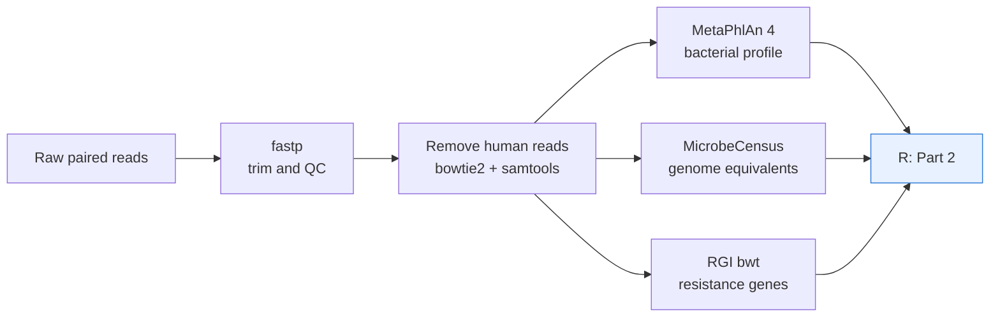

# DAWG Workshop #2: Profiling Metagenomes by Short-Read Mapping

## Overview

This workshop shows how to profile a gut metagenome by **short-read mapping**: reads are mapped to reference databases to find out *who is there* (bacterial taxonomy) and *which antimicrobial resistance genes are there* (the resistome). We then analyse the resulting tables in R to ask how a community changes over time.

You will learn how to:

- run and interpret the tools used to profile metagenomes (MetaPhlAn 4, RGI bwt, MicrobeCensus),
- measure **alpha diversity** (richness) and **beta diversity** (how different samples are) in a longitudinal study,
- find which species, resistance genes and drug classes change over time with **MaAsLin3**.

> [!IMPORTANT]
> **The hands-on session is in R, using tables that have already been generated.** We do **not** run raw sequencing data through the pipeline during the workshop, and you do not need an HPC account. You will receive a **workspace image** (an `.RData` file) containing every intermediate table. Part 1 is provided so you can see exactly how those tables were made and reuse the pipeline on your own data.

**Workshop materials (workspace image and slides):** [link to be added]

---

## Where to start

| Part | Document | What it covers | Do you run it in the workshop? |
|---|---|---|---|
| 1 | [**01_run_profiling.md**](01_run_profiling.md) | The SLURM pipeline that turns raw paired-end reads into taxonomic, resistance-gene and genome-equivalent tables | **Read only.** Reference for how the tables were made |
| 2 | [**02_analysis.md**](02_analysis.md) | Read QC, alpha and beta diversity, and differential abundance in R | **Yes, this is the hands-on part** |

Suggested route: skim this page, then work through **Part 2**. Read Part 1 when you want to know how the input tables were generated or want to run the pipeline on your own samples.

---

## The study

We use the data from **Palleja et al. 2018**, "Recovery of gut microbiota of healthy adults following antibiotic exposure", *Nature Microbiology* 3, 1255-1265 ([doi:10.1038/s41564-018-0257-9](https://doi.org/10.1038/s41564-018-0257-9)). The sequencing reads are public in the European Nucleotide Archive, project **PRJEB20800**.

**Question the study asked:** if a healthy person takes a short course of strong antibiotics, how badly is the gut microbiota disturbed, and does it come back?

**Study design**

- **12 healthy young men** took a **4-day course** of three broad-spectrum antibiotics: meropenem, gentamicin and vancomycin. This mimics preventive treatment sometimes given in intensive care.
- **Stool samples** were collected before treatment (**baseline**) and at four later timepoints over about six months, and sequenced by shotgun metagenomics.
- Each person is their own control: there is **no untreated comparison group**. We therefore look at change **relative to each person's own baseline**.

**What the authors reported**

- Bacterial diversity fell sharply and then recovered to close to baseline within about 1.5 months.
- Nine common species were still undetectable in most people at six months.
- Bacteria carrying beta-lactam resistance genes were selected for during and after treatment.

**Why this dataset suits a workshop:** it is a clean longitudinal design (the same people sampled repeatedly), with a strong, known perturbation. That makes it a good place to learn why repeated measures need special statistics, and gives a result you can check against the paper.

> [!NOTE]
> Only the **paired-end** reads from the project were processed.

---

## The workflow



Everything left of **R** is Part 1 (already done for you). Part 2 starts from the tables it produced.

---

## Tools used

| Tool | What it does | Used in |
|---|---|---|
| [fastp](https://github.com/OpenGene/fastp) | Trims adapters and low-quality ends, removes poly-G tails, writes a QC report | Part 1 |
| [bowtie2](https://github.com/BenLangmead/bowtie2) + [samtools](https://github.com/samtools/samtools) | Align reads to the human genome so human reads can be removed | Part 1 |
| [MetaPhlAn 4](https://github.com/biobakery/MetaPhlAn) (v4.2.2) | Maps reads to species-specific marker genes to estimate which bacteria are present and how many reads each has | Part 1 |
| [MicrobeCensus](https://github.com/snayfach/MicrobeCensus) | Estimates average genome size and **genome equivalents**, used to put resistance-gene counts on a comparable scale | Part 1 |
| [RGI bwt](https://github.com/arpcard/rgi) with [CARD](https://card.mcmaster.ca/) | Maps reads to known antimicrobial resistance genes and counts them | Part 1 |
| R: `vegan`, `lme4`, `lmerTest` | Diversity, distances, PERMANOVA and mixed models | Part 2 |
| [MaAsLin3](https://github.com/biobakery/maaslin3) | Finds species, genes and drug classes that change over time, accounting for repeated samples | Part 2 |

Short explanations of how each tool works are in [Part 1, section 2](01_run_profiling.md#2-what-each-tool-does).

---

## Software you need

### To follow the workshop (Part 2)

- **R 4.3 or newer** ([download](https://cloud.r-project.org/)) and, optionally, [RStudio](https://posit.co/download/rstudio-desktop/).
- The R packages below. Run this once, **before** the workshop, as the first install can take a while:

```r
install.packages(c(
  "magrittr", "dplyr", "tidyr", "tibble", "readr", "stringr", "purrr",
  "ggplot2", "scales", "jsonlite", "vegan", "permute", "lme4",
  "lmerTest", "broom.mixed", "BiocManager"
))
BiocManager::install("biobakery/maaslin3")
```

- The **workspace image**, from the materials link above. Put it in an `rdata/` folder inside your working directory (Part 2 explains the folder layout).

> [!TIP]
> Check the install worked: `library(maaslin3)` and `library(vegan)` should load without an error.

### To run the pipeline yourself (Part 1, optional)

Not needed for the workshop. If you later want to profile your own samples, you need a SLURM cluster (or a Linux machine) and the tools linked in the table above. Part 1 lists the versions we used and links to each tool's own installation instructions.

---

## Data files

| File | Where it comes from | In the workshop? |
|---|---|---|
| Workspace image (`part2_workspace.RData`) | Built from the Part 1 output plus sample metadata | Provided to you |
| Raw sequencing reads | ENA project PRJEB20800 | Not provided or needed |
| Part 1 `results/` folder | Output of the pipeline | Not provided; its tables are inside the image |

---

## Questions

If something does not work, bring the exact error message and the output of `sessionInfo()` to the workshop.

---

## References

- Palleja A, et al. Recovery of gut microbiota of healthy adults following antibiotic exposure. *Nat Microbiol* 3, 1255-1265 (2018). doi:10.1038/s41564-018-0257-9
- Blanco-Miguez A, et al. Extending and improving metagenomic taxonomic profiling with uncharacterized species using MetaPhlAn 4. *Nat Biotechnol* 41, 1633-1644 (2023).
- Alcock BP, et al. CARD 2023. *Nucleic Acids Res* 51, D690-D699 (2023).
- Nayfach S, Pollard KS. Average genome size estimation improves comparative metagenomics. *Genome Biol* 16, 51 (2015).
- Nickols WA, et al. MaAsLin 3. *bioRxiv* (2024). doi:10.1101/2024.12.13.628459
